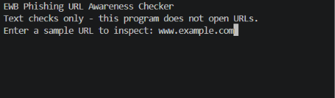
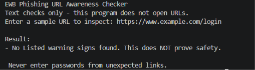

# EWB Phishing URL Awareness Checker
## Overview
[Phishing is the process of stealing sensitive information to prevent this i made this to make awareness of what website is real and fake]
## Features
- Detects an @ symbol in the URL
- Flags unusually long URLs (over 100 characters)
- Flags IP-address hostnames
- Flags many hostname segments (5 or more)
- Flags punycode-style hostnames (xn--)
- Flags the HTTP scheme
EWB COURSES Cybersecurity Mini Project Workbook | Phishing URL Awareness Checker
Student Project Workbook • Defensive learning only Page 17
- [Added a try-except block around Python's urlparse function to safely handle malformed or invalid text strings, preventing unexpected program crashes. Tested using various invalid URL formats.]
- [Added a has_warnings helper function and conditional logic to dynamically count and display the total number of warning signs found for suspicious links. Tested against all sample inputs.]
## Requirements
Python 3.10 or later. No extra packages.
## How to Run
Windows: python phishing_checker.py
Mac/Linux: python3 phishing_checker.py
## Example Output
[Enter a sample URL (or type q to quit): https://xn--example.invalid/

Result:
- Container a punycode-style hostname.

REVIEW CAREFULLY: 1 warning sign(s) found.

 Never enter passwords from unexpected links.
]
## Testing
| # | Input | Expected | Actual | Result |
|---|-------|----------|--------|--------|
| 1 | https://www.example.com/login | No warning signs | [No warning signs] | [PASS] |
| 2 | http://192.0.2.10/account | IP address & HTTP warnings| IP address & HTTP warnings | [PASS] |
[Add rows 2 to 5. Full table is in tests/test_samples.md]
## Screenshots

## Improvements
1. [Santhosh] - [1. **URL Format Validation** - Wrapped Python's `urlparse` function in a `try-except` block. This changed how malformed input text is handled so the program gracefully reports an invalid format instead of crashing with a ValueError, verified by testing with broken or text-only strings.]
2. [Santhosh] - [2. **Review Carefully Summary** - Added a `has_warnings` helper function and conditional logic to check findings. This changed the output to dynamically display a total warning count summary for suspicious links, verified by running all sample test cases.]
## Limitations
This is an educational tool. It only reads URL text. It does not visit
URLs, scan for malware or prove that a URL is safe. No warning signs
found does NOT mean a URL is safe.
## Ethical Use
Use sample strings only. Do not collect credentials. Do not use this
project to deceive anyone or to test websites without permission.
## Author
[A.Giridhar Sai Santhosh], [Cybersecurity], EWB Courses
